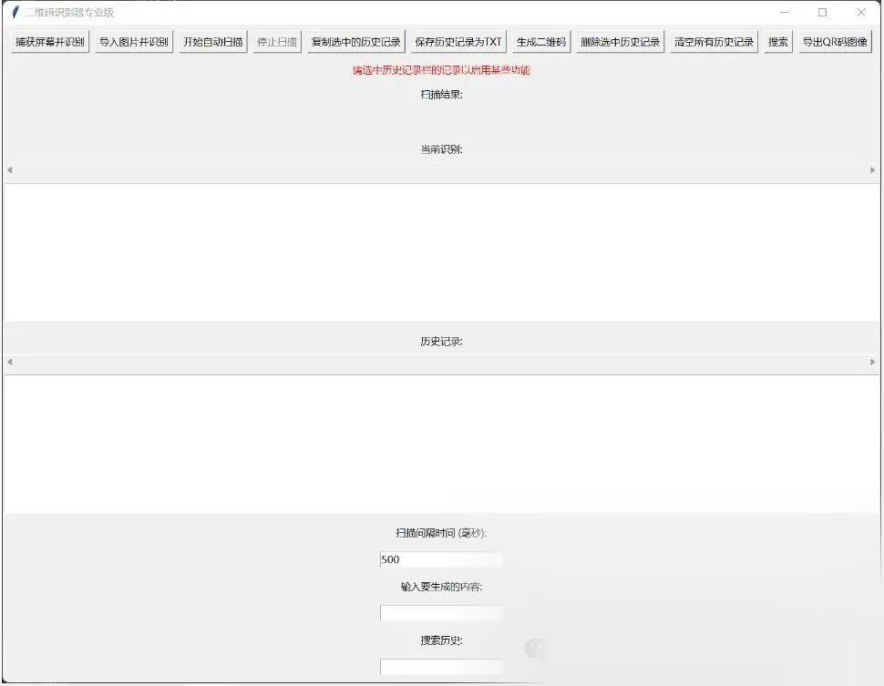

# [python] Fully automatic QR code recognition

To achieve full-screen QR code recognition, automatic scanning, copying the link, generating a simple QR code, and converting the recognized content into txt.

-
-
-
-
-
-
-
-
-
-
-
-
-
-
-
-
-
-
-
-
-
-
-
-
-
-
-
-
-
-
-
-
-
-
-
-
-
-
-
-
-
-
-
-
-
-
-
-
-
-
-
-
-
-
-
-
-
-
-
-
-
-
-
-
-
-
-
-
-
-
-
-
-
-
-
-
-
-
-
-
-
-
-
-
-
-
-
-
-
-
-
-
-
-
-
-
-
-
-
-
-
-
-
-
-
-
-
-
-
-
-
-
-
-
-
-
-
-
-
-
-
-
-
-
-
-
-
-
-
-
-
-
-
-
-
-
-
-
-
-
-
-
-
-
-
-
-
-
-
-
-
-
-
-
-
-
-
-
-
-
-
-
-
-
-
-
-
-
-
-
-
-
-
-
-
-
-
-
-
-
-
-
-
-
-
-
-
-
-
-
-
-
-
-
-
-
-
-
-
-
-
-
-
-
-
-
-
-
-
-
-
-
-
-
-
-
-
-
-
-
-
-
-
-
-
-
-
-
-
-
-
-
-
-
-
-
-
-
-
-
-
-
-
-
-
-
-
-
-
-
-
-
-
-
-
-
-
-
-
-
-
-
-
-
-
-
-
-
-
-
-
-
-
-
-
-

```
import pyautoguifrom PIL import Imagefrom pyzbar.pyzbar import decodeimport tkinter as tkfrom tkinter import Label, Button, Listbox, Entry, END, SINGLE, filedialogimport threadingimport timeimport qrcodefrom PIL import ImageTkimport cv2
class QRCodeScannerApp:    def __init__(self, root):        self.root = root        self.root.title("QR Code Recognition Professional Edition")
        # Set the default size of the window        self.root.geometry("1600x1200")
        # Create a top-level feature button area        self.button_frame = tk.Frame(root)        self.button_frame.pack(pady=10)
self.prompt_label = Label(root, text="Please select a record in the history bar to enable certain features", fg="red")
# Move all buttons to button_frame. Set them to a horizontal layout... self.capture_button = Button(self.button_frame, Output: "Capture the screen and identify" command=self.capture_screen_and_recognize)        self.capture_button.grid(row=0, column=0, padx=5)
self.batch_scan_button = Button(self.button_frame, Output: "Import an image and recognize it." command=self.batch_scan)        self.batch_scan_button.grid(row=0, column=1, padx=5)
self.autoscan_button = Button(self.button_frame, Output: "Starting automatic scanning" command=self.start_auto_scan)        self.autoscan_button.grid(row=0, column=2, padx=5)
self.stop_button = Button(self.button_frame, Output: "Stop scanning" command=self.stop_scan, state=tk.DISABLED)        self.stop_button.grid(row=0, column=3, padx=5)
self.copy_button = Button(self.button_frame, Output: "Copy the selected history records" command=self.copy_selected_history)        self.copy_button.grid(row=0, column=4, padx=5)
self.save_button = Button(self.button_frame, Output: "Save history as TXT" command=self.save_history_to_txt)        self.save_button.grid(row=0, column=5, padx=5)
self.generate_button = Button(self.button_frame, Output: "Generate QR Code" command=self.generate_qrcode)        self.generate_button.grid(row=0, column=6, padx=5)
self.delete_history_button = Button(self.button_frame, Output: "Delete selected history" command=self.delete_selected_history)        self.delete_history_button.grid(row=0, column=7, padx=5)
self.clear_history_button = Button(self.button_frame, text="Clear all history records" command=self.clear_all_history)        self.clear_history_button.grid(row=0, column=8, padx=5)
self.search_button = Button(self.button_frame, Output: "Search" command=self.search_history)        self.search_button.grid(row=0, column=9, padx=5)
self.export_button = Button(self.button_frame, Output: "Export QR code image" command=self.export_qr_code)        self.export_button.grid(row=0, column=10, padx=5)
        # Text and input section        self.label = Label(root, text="Scanning result:")        self.label.pack(pady=10)
        self.result_label = Label(root, text="", wraplength=500)        self.result_label.pack(pady=10)
        self.current_label = Label(root, text="Current recognition:")        self.current_label.pack(pady=10)
        # Increase width        self.current_listbox_scrollbar = tk.Scrollbar(root, orient=tk.HORIZONTAL)        self.current_listbox_scrollbar.pack(fill=tk.X)        self.current_listbox = Listbox(root, selectmode=SINGLE, height=10, width=250,                                       xscrollcommand=self.current_listbox_scrollbar.set)        self.current_listbox.pack(pady=10)        self.current_listbox_scrollbar.config(command=self.current_listbox.xview)
        self.history_label = Label(root, text="History:")        self.history_label.pack(pady=10)
        self.history_listbox_scrollbar = tk.Scrollbar(root, orient=tk.HORIZONTAL)        self.history_listbox_scrollbar.pack(fill=tk.X)        self.history_listbox = Listbox(root, selectmode=SINGLE, height=10, width=250,                                       xscrollcommand=self.history_listbox_scrollbar.set)        self.history_listbox.pack(pady=10)        self.history_listbox_scrollbar.config(command=self.history_listbox.xview)
self.interval_label = Label(root, text="Scan interval time (ms):")        self.interval_label.pack(pady=10)
        self.interval_entry = Entry(root)        self.interval_entry.pack(pady=10)        self.interval_entry.insert(0, "500")
self.generate_label = Label(root, text="Enter the content to generate:")        self.generate_label.pack(pady=10)
        self.generate_entry = Entry(root)        self.generate_entry.pack(pady=10)
self.search_label = Label(root, text="Search History:") self.search_label.pack(pady=10)
        self.search_entry = Entry(root)        self.search_entry.pack(pady=10)
        # Other attributes        self.auto_scanning = False        self.history = []        self.history_counter = 0        self.seen_qrcodes = set()
    def clear_all_history(self):        self.history.clear()        self.history_listbox.delete(0, END)
    # Function to add search history    def search_history(self):        query = self.search_entry.get().lower()        self.history_listbox.delete(0, END)        for item in self.history:            if query in item.lower():                self.history_listbox.insert(END, item)
    def export_qr_code(self):        selected_index = self.history_listbox.curselection()        if selected_index:            selected_data = self.history[int(selected_index[0])]            content_without_number = selected_data.split(': ', 1)[-1]
# Creating a QR Code image using the PIL library error_correction=qrcode.constants.ERROR_CORRECT_L, box_size=10, border=4)            qr.add_data(content_without_number)            qr.make(fit=True)            qr_image = qr.make_image(fill_color="black", back_color="white")
# Choose the save path file_path = filedialog.asksaveasfilename(defaultextension=".png", filetypes=[("PNG Files", "*.png")])
            # If the user has selected a path, saveQRImage code            if file_path:                qr_image.save(file_path)
    # Add a new function to generate QR codes and display them in a new window.    def generate_qrcode(self):        qr_data = self.generate_entry.get()        if qr_data:            qr = qrcode.QRCode(version=1, error_correction=qrcode.constants.ERROR_CORRECT_L, box_size=10, border=4)            qr.add_data(qr_data)            qr.make(fit=True)            img = qr.make_image(fill_color="black", back_color="white")
            # Display QR code in a new window            new_window = tk.Toplevel(self.root)            new_window.title("Generated QR code")
            qr_image = ImageTk.PhotoImage(img)  # Output:PILImage toTkinterAvailable images            qr_label = Label(new_window, image=qr_image)            qr_label.image = qr_image  # Save references to images to prevent garbage collectors from collecting them.            qr_label.pack()
    def start_auto_scan(self):        """Start automatic scanning"""        self.auto_scanning = True        self.autoscan_button.config(state=tk.DISABLED)        self.stop_button.config(state=tk.NORMAL)        self.auto_scan()
def stop_scan(self):        """Stops the automatic scanning"""        self.auto_scanning = False        self.autoscan_button.config(state=tk.NORMAL)        self.stop_button.config(state=tk.DISABLED)
    def auto_scan(self):        if self.auto_scanning:            # Start a thread to perform screen capture and QR code recognition in an asynchronous manner.            threading.Thread(target=self.capture_screen_and_recognize, daemon=True).start()
            try:                interval = int(self.interval_entry.get())            except ValueError:                interval = 500            self.root.after(interval, self.auto_scan)
    def capture_screen_and_recognize(self):        start_time = time.time()        screenshot = pyautogui.screenshot()        image = Image.frombytes('RGB', screenshot.size, screenshot.tobytes())        decoded_objects = decode(image)
        new_qrcodes = []
        if decoded_objects:            for obj in decoded_objects:                data = obj.data.decode("utf-8")                if data not in self.seen_qrcodes:  # If this is a new QR code data                    self.seen_qrcodes.add(data)                    new_qrcodes.append(data)
If new_qrcodes:  # If there are new QR codes, clear the current recognition listbox                self.current_listbox.delete(0, END)
            elapsed_time = time.time() - start_time  # Calculate the time spent            self.result_label.config(text=f"Identified {len(new_qrcodes)} A new QR code, time-consuming {elapsed_time:.3f} Second")
            for i, data in enumerate(new_qrcodes):                self.history_counter += 1                self.current_listbox.insert(END, f"{self.history_counter}: {data}")                self.history.append(f"{self.history_counter}: {data}")                self.history_listbox.insert(END, f"{self.history_counter}: {data}")        else:            self.result_label.config(text="No QR code found")
    def copy_selected_history(self):        selected_index = self.history_listbox.curselection()        if selected_index:            selected_data = self.history[int(selected_index[0])]            # Use string slicing to remove the number.            content_without_number = selected_data.split(': ', 1)[-1]            self.root.clipboard_clear()            self.root.clipboard_append(content_without_number)            self.root.update()
    def save_history_to_txt(self):        file_path = filedialog.asksaveasfilename(defaultextension=".txt", filetypes=[("Text Files", "*.txt")])        if file_path:            with open(file_path, "w") as file:                for item in self.history:                    file.write(item + "\n")
    # Add a new function to batch scan images.    def batch_scan(self):        file_paths = filedialog.askopenfilenames(title="Select image", filetypes=[("Image Files", "*.png;*.jpg;*.jpeg")])
        for file_path in file_paths:            image = cv2.imread(file_path)
# Adjust image size. To adapt to the resolution of screen captures. (self.root.winfo_screenwidth(), self.root.winfo_screenheight()))            screenshot = Image.fromarray(cv2.cvtColor(scaled_image, cv2.COLOR_BGR2RGB))
            # Identify QR codes on screen screenshots            decoded_objects = decode(screenshot)
            new_qrcodes = []
            if decoded_objects:                for obj in decoded_objects:                    data = obj.data.decode("utf-8")                    if data not in self.seen_qrcodes:  # If this is a new QR code data                        self.seen_qrcodes.add(data)                        new_qrcodes.append(data)
                for i, data in enumerate(new_qrcodes):                    self.history_counter += 1                    self.current_listbox.insert(END, f"{self.history_counter}: {data}")                    self.history.append(f"{self.history_counter}: {data}")                    self.history_listbox.insert(END, f"{self.history_counter}: {data}")            else:                self.result_label.config(text="No QR code found")
self.root.update()  # Update the GUI to display the result
    # Functions for adding, deleting, and clearing history.    def delete_selected_history(self):        selected_index = self.history_listbox.curselection()        if selected_index:            del self.history[int(selected_index[0])]            self.history_listbox.delete(selected_index)
if __name__ == "__main__":    root = tk.Tk()    app = QRCodeScannerApp(root)    root.mainloop()
```




## Payment

Here is a pay link on Stripe ( https://buy.stripe.com/3cs8yP7sY87d0vu9AB ). Please contact me lonlonago@foxmail.com after funding $89, and I will send you a complete data files , thank you!


